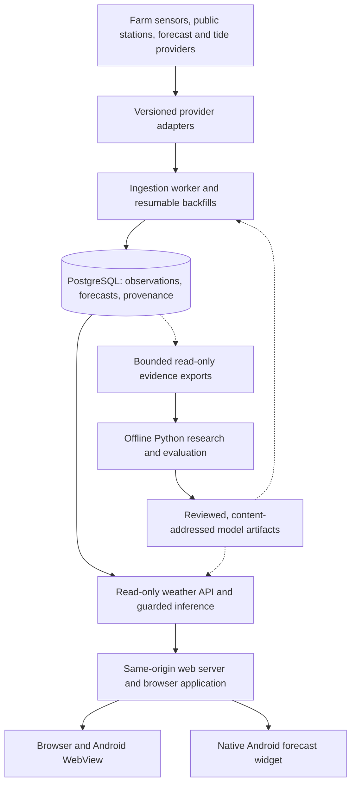

# Weather: An Evidence-Governed Hyperlocal Intelligence Platform

### A technical case study in applied machine learning, full-stack architecture, and production systems engineering

**[Live platform](https://weather.ballydidean.farm)** ·
**[Forecast experience](https://weather.ballydidean.farm/forecast)** ·
**[Architecture](#2-system-architecture)** ·
**[ML methodology and results](#4-applied-machine-learning)** ·
**[Development](#9-reproducing-the-engineering-workflow)**

## Abstract

Weather is a production weather intelligence platform built for Ballydidean
Farm. It integrates first-party environmental sensors, heterogeneous public
station networks, regional forecast models, air-quality observations, and tide
feeds into a provenance-aware data system. That foundation supports a browser
application, a native Android companion and forecast widget, and a controlled
pipeline for learning hyperlocal forecast corrections.

The central engineering problem is not displaying weather or fitting a model.
It is preserving trust across the entire path from an unreliable external
measurement to a prediction someone uses: what was measured, what was modeled,
what was known at prediction time, what changed later, and whether the evidence
justifies changing the forecast served in production.

The implementation spans TypeScript/Node.js services, PostgreSQL, Python model
research, portable TypeScript inference, accessible browser interfaces, Kotlin
Android clients, and immutable ARM64 container delivery. Its organizing principle
is **evidence before authority**: a successful fit is not a qualified model, a
historical replay is not an issued forecast, and a monitoring result is not
permission to alter production.

### Engineering evidence at a glance

| Dimension | Evidence in this repository |
| --- | --- |
| End-to-end ownership | Provider ingestion, PostgreSQL, public API, protected administration, web/PWA, and native Android |
| Applied intelligence | Three independently controlled forecast-adjustment families: temperature, wind, and rain |
| Research-to-production delivery | Python-trained models exported to deterministic TypeScript inference with parity fixtures |
| Operational discipline | Exact-commit CI, inspected immutable ARM64 images, bounded authority, and live release verification |

## 1. Problem formulation and design objectives

A farm needs local information, while regional forecasts describe grid cells
and nearby stations observe different microclimates. Combining them introduces
more than a visualization problem. Providers disagree on units, timestamps,
sampling intervals, forecast vintages, sensor identity, and historical coverage.
An apparently better model can simply be exploiting revised observations or
information that was unavailable when the forecast would have been issued.

Weather addresses these constraints as one connected engineering problem:

| Objective | Implemented response |
| --- | --- |
| Integrate heterogeneous sources without erasing their meaning | Canonical metrics, explicit source kinds, versioned adapters, and material-configuration fingerprints |
| Recover from interrupted ingestion without corrupting history | Transactional checkpoints, exact backfill-chunk identities, bounded retries, and resumable imports |
| Improve forecasts without hiding the baseline | Separate raw and adjusted values, source-specific eligibility, bounded corrections, and independent serving controls |
| Make model claims auditable | Chronological evaluation, causal feature construction, content-addressed evidence, and explicit evidence classes |
| Keep optional intelligence from becoming a service dependency | Deterministic inference and fail-raw behavior when model inputs, artifacts, or checks are invalid |
| Deliver a complete product on constrained infrastructure | Browser and native clients, isolated containers, exact-commit CI, immutable releases, and live verification |

AI fluency here is demonstrated through causal data contracts, reproducible
model research, cross-language inference, and evidence-aware production delivery.
The predictive methods are statistical machine learning rather than generative AI.

## 2. System architecture

The runtime is a modular TypeScript monorepo with separate ingestion, API, and
web processes. Python research runs outside the public request path. Reviewed
numerical artifacts cross that boundary; private training corpora do not.



### Enforced module boundaries

| Workspace | Responsibility | Allowed internal dependencies |
| --- | --- | --- |
| `@weather/domain` | Units, records, provenance, ingestion and forecast contracts | None |
| `@weather/database` | PostgreSQL persistence, migrations and repositories | Domain |
| `@weather/providers` | External protocol adapters and normalization | Domain |
| `@weather/forecast-adjustment` | Pure evaluation, evidence, artifact and inference contracts | Domain |
| `@weather/worker` | Scheduling, ingestion, backfills and operator CLI composition | Domain, database, providers, forecast adjustment |
| `@weather/api` | Public reads and independently guarded model application | Domain, database, forecast adjustment |
| `@weather/web` | Browser presentation over JSON contracts | None |

These are executable constraints, not just a diagram.
The [repository linter](scripts/lint.mjs) checks workspace manifests and source
imports. The [build orchestrator](scripts/build-workspaces.mjs) discovers the
dependency graph, rejects cycles, and compiles dependencies before consumers.
[Strict TypeScript settings](tsconfig.base.json) include unchecked-index and
exact-optional-property checks.

## 3. Data engineering: provenance as a first-class contract

### One schema, multiple kinds of truth

The domain distinguishes physical measurements, model-derived current
conditions, reanalysis, forecasts, observed tide levels, and tide predictions.
A model-derived value cannot silently become an on-site observation.

Each normalized weather record retains source identity, valid time, receipt
time, forecast product-run time where applicable, canonical metric units, and
bounded device, model, quality, and provider metadata. Missing measurements stay
missing; hourly model products are not interpolated into fictitious minute-level
observations. The separation of valid time, receipt time, and model-run time
also supplies the temporal foundation for causal ML evaluation.

The [record contract](packages/domain/src/weather-record.ts),
[provenance contract](packages/domain/src/provenance.ts), and
[sensor inventory](docs/sensor-measurements.md) define these semantics explicitly.

### Integration breadth without provider coupling

| Source family | Integration concern |
| --- | --- |
| Ecowitt GW3000 and farm sensors | LAN polling, gateway MAC verification, optional sensor fields, and explicit rain-gauge preference |
| WeatherFlow Tempest | Completed-hour polling that retains distinct minute observations; day-bounded historical requests |
| Ambient Weather, Weather Underground and Netatmo | Different historical windows, provider pacing, module timing, and nonoverlapping source handoffs |
| PurpleAir | Two-minute particulate observations with explicit channel aggregation and enclosure-sensor semantics |
| Open-Meteo | Regional current conditions, reanalysis, live forecast snapshots, and separately identified historical forecast anchors |
| NOAA CO-OPS | Observed Port Townsend water levels and Glendale tide predictions, preserving MLLW datum and UTC time |

Some public-station integrations use public web-client interfaces rather than
contractual bulk-data APIs. That fragility is contained behind
[provider contracts](packages/providers/src/contract.ts), response-size limits,
classified errors, redacted diagnostics, deadlines, and source-specific pacing.
It is not treated as an upstream reliability guarantee.

### Recovery and identity

Historical ingestion is chunked and resumable. A successful chunk is reusable
only when its source, material-configuration fingerprint, adapter version,
chunk-plan version, and exact half-open interval match. A configuration or
adapter change therefore cannot accidentally inherit an unrelated completion
checkpoint. Scheduled ingestion commits records and progress transactionally.

The [ingestion contracts](packages/domain/src/ingestion.ts) and
[database repositories](packages/database/src/repositories.ts) make recovery
part of the data model rather than a collection of ad hoc retry scripts.

## 4. Applied machine learning

### Research-to-runtime portability

The system learns local corrections to upstream forecasts rather than attempting
to replace numerical weather prediction. Research and serving use deliberately
different environments:

- **Research:** Python experiments, causal feature generation, chronological
  development panels, independent verification, and private evidence retention.
- **Artifact boundary:** sanitized coefficients or tree structures, explicit
  feature schemas, source identities, authorization, and SHA-256 content hashes.
- **Serving:** deterministic TypeScript inference inside the existing API or
  worker, without a Python model server or a remote inference dependency.

| Model family | Numerical approach | Production boundary |
| --- | --- | --- |
| Temperature | Direct and adaptive robust ridge/model output statistics (MOS), with source-specific ECMWF inputs and causal recent-error features | Frozen coefficients, eligible lead bands, receipt/freshness checks, correction caps, and independent raw fallback |
| Wind speed and gust | Portable hierarchical correction coefficients and lead-band transfer evidence | Explicit enabled-band masks; gust hours 49–72 remain disabled |
| Rain | Four-head XGBoost hurdle model: three occurrence classifiers and one Gamma amount head, using 107 causal features | Exported tree representation, native TypeScript scoring, missing-value branch parity, and bounded worker-produced decisions |

The rain path is a concrete cross-language engineering example: Python-trained
models are exported into a portable representation, while fixtures test feature
and prediction parity with the native scorer. The production request path does not
need the training framework. See the
[inference package](packages/forecast-adjustment/src/),
[rain exporter](scripts/research/export_rain_wind_runtime.py), and
[temperature research](docs/operations/temperature-shortlead-models.md).

### Quantitative evidence, with its scope attached

The recorded temperature transfer replay provides a useful result without
requiring a claim of universal or perpetual model superiority:

| Frozen-forward temperature replay | Recorded result |
| --- | --- |
| Population | 25,968 events across 546 dates, six launch vintages and their next two months |
| Equal-date mean absolute error, raw | 1.320443 °C |
| Equal-date mean absolute error, adjusted | 1.062427 °C |
| Relative MAE improvement | **19.54%** |
| 95% interval for improvement | 16.30%–22.66%, using 1,000 deterministic seven-day-block bootstrap samples |
| 95th-percentile absolute error | 3.7000 °C raw → 2.8866 °C adjusted |

**Interpretation:** this is frozen-forward replay evidence that reuses
development data. It supports a transfer argument; it is not an independent
prospective trial, a current as-issued accuracy report, or proof of lasting
skill. The exact population, cutoff, digest, and limitations are recorded in the
[permanent-serving policy](docs/operations/forecast-model-live-readiness.md).

Negative results are retained too. The rain candidate passed **43 of 49**
development gates, not all 49; seasonal, detection, and heavy-rain weaknesses
remain documented. Its serving path is explicitly operator-authorized rather
than statistically qualified. The distinction matters more than presenting an
unqualified headline improvement. See
[rain research](docs/operations/rain-wind-research.md) and the
[rain serving contract](docs/operations/rain-live-adjustment.md).

## 5. Model governance as executable software

### Preventing temporal leakage and misleading comparisons

Historical Previous Runs anchors and live retrieval-snapshot cohorts retain
separate identities. Causal features must respect information availability;
chronological splits and embargoes prevent nearby observations from leaking
across development and evaluation boundaries. Holdout accounting records opened
evidence rather than allowing an unfavorable holdout to be reset and reused.

The performance system further distinguishes four evidence populations:

| Evidence class | What it can establish |
| --- | --- |
| `as_issued` | The values actually committed by the serving edge |
| `prospective_receipt` | A source-run reconstruction backed by a verified before-valid edge receipt |
| `retrospective_counterfactual` | A historical reconstruction without that prospective receipt |
| `development` | An experiment on evidence already opened for development |

These populations are not pooled into one accuracy number. Edge commitment is
also not misrepresented as proof that a browser received the response. Raw and
adjusted forecasts are scored against identical target rows, with equal local
date, hour, and genuine-vintage weighting. Current scorecard uncertainty uses
paired seven-local-date moving blocks, including local-calendar/DST semantics.
Insufficient support produces null metrics and `pending_support`, not zero error.

### Independent authority and failure boundaries

Content-addressed bundles and runtime loaders bind model bytes to their evidence,
source contracts, and authorization. Temperature, wind, and rain have independent
serving gates. Disabling one restores its raw values without disabling the other
families; temperature and wind additionally retain emergency kill switches.
Invalid artifacts or ineligible inputs fail raw rather than interrupting the
underlying forecast service.

The checked configuration selects separately authorized temperature, wind, and
rain paths. The generic qualified-model registry remains inactive. Permanent
authorization changes serving duration, not evidence quality. Monitoring and
scorecard publication do not themselves grant promotion authority.

Future rolling-maintenance components include immutable revision transport,
content-addressed evidence graphs, leases, fencing, and family-scoped release
contracts. They are **not presented as a production-ready autonomous promotion
service**: scheduling and model actions remain gated by their live prerequisites.
Likewise, experimental UV, pressure, and cloud corrections retain zero-strength
serving policies pending independent prospective evidence.

Further detail: [forecast governance](docs/operations/forecast-adjustment.md),
[as-issued measurement](docs/operations/adjustment-performance.md),
[maintenance integration](docs/operations/adjustment-maintenance-integration.md),
and [prospective correction protocol](docs/operations/local-forecast-corrections.md).

## 6. Full-stack product engineering

The user-facing system carries those data and model distinctions through to the
interface rather than hiding them behind a single weather number.

- **Browser product:** current conditions, multi-day forecasts, recorded
  observations, trend charts, nearby-station maps, tide information, bounded
  history filters, and persistent unit preferences.
- **Honest presentation:** source attribution, freshness, raw/adjusted
  distinctions, unavailable states, and last-good-data recovery. Missing weather
  inputs do not become invented fair-weather icons.
- **Accessible interaction:** native keyboard controls, responsive layouts,
  descriptive labels, and native widget TalkBack descriptions with provenance
  and freshness.
- **Installable web experience:** a standalone manifest and offline application
  shell, while data availability remains explicit rather than implied by caching.
- **Native Android:** a credential-free hosted-site companion plus a Kotlin
  RemoteViews forecast widget, with versioned public snapshots, deterministic
  shared fixtures, and native cache/scheduling/rendering adapters.

The public weather API accepts only GET and HEAD. Bounded filtering and cursor
pagination constrain reads, while public health responses expose readiness and
coarse freshness without credentials, database topology, or raw errors.
Administrator mutations live behind a separate authenticated web boundary;
they do not turn the public data API into a write interface.

The browser has no UI framework, charting library, or internal workspace
dependency. This keeps the JSON contract boundary explicit, but also makes
presentation complexity a responsibility of the project rather than a framework.
Android distribution is currently internal testing; a native iOS client is not
claimed as a delivered product.

Explore the [web implementation](apps/web/src/),
[API contracts](apps/api/src/index.ts),
[Android project](mobile/android/README.md), and
[mobile verification runbook](docs/operations/mobile.md).

## 7. Production delivery, security, and recovery

Weather runs on the Blueberry ARM64 host behind the production HTTPS origin.
Its operational design emphasizes isolation, reproducibility, and bounded
authority rather than introducing a distributed platform for a single-site
workload.

- **Immutable delivery:** dated release tags resolve to published image digests.
  Publication uses successful checks for the exact source commit; deployment
  retains image-boundary inspection, release identity, migration readiness,
  health checks, and affected live-page verification.
- **Least-privilege boundaries:** file-mounted credentials, non-root services,
  isolated container networks, forced-command SSH operations, and bounded
  read-only production research exports.
- **Private-data containment:** raw research evidence, credentials, model working
  directories, backups, and local native evidence are excluded from the Docker
  build context. Only reviewed serving material is admitted to runtime artifacts.
- **Recovery with explicit scope:** encrypted database backups are decrypted and
  validated before replacing the retained local copy; disposable restore checks
  test recovery separately from backup creation. Model disablement, forward
  compensation, and prior-image rollback have distinct prerequisites.
- **Resource-aware operation:** deployment capacity uses actual available space
  and image identities, not hypothetical cleanup savings. Evidence exports have
  explicit row, byte, memory, and date-range limits.

The default direct deployment applies forward migrations and starts immutable
images; it does **not** implicitly perform a compatibility database clone or a
pre-migration backup. Those guarantees must not be inferred from a successful
deployment. See the [deployment runbook](docs/operations/raspberry-pi.md),
[backup and restore contract](docs/operations/backup-restore.md),
[container build](Dockerfile), and [build exclusions](.dockerignore).

## 8. Verification strategy and architectural trade-offs

Verification targets different failure classes rather than relying on one
undifferentiated test count:

| Layer | Evidence |
| --- | --- |
| Domain and numerical behavior | Deterministic unit fixtures, causal-boundary tests, artifact validation, and cross-language inference parity |
| Persistence and API composition | Disposable PostgreSQL integration tests, migrations, provider fixtures, role boundaries, and transactional recovery |
| User experience | Playwright Chromium acceptance tests for desktop/mobile behavior and explicit unavailable/recovery states |
| Native delivery | Shared widget contracts, Kotlin tests, native host evidence, and separate visual verification |
| Operations | Static deployment checks plus disposable lifecycle, persistence, network, secret, and backup/restore rehearsals |
| Release | Exact-commit CI, published-image inspection, health/identity checks, and affected production behavior |

The [Check workflow](.github/workflows/check.yml) selects dependent suites only
from a verified baseline. Unknown baselines, nightly runs, and manual checks use
full coverage. Compilation is shared across compiled suites to avoid repeatedly
building the same dependency graph.

Several deliberate trade-offs define the project:

| Decision | Benefit | Cost or limit |
| --- | --- | --- |
| PostgreSQL and a small set of services instead of a streaming platform | Transactional consistency and a manageable operational surface | Not a claim of global-scale throughput or high availability |
| Native TypeScript inference instead of a Python serving tier | Fewer runtime dependencies and a testable artifact boundary | Requires export tooling and numerical parity verification |
| Framework-light browser implementation | Direct control of rendering, payloads, and contracts | More in-house responsibility for UI structure and accessibility |
| Explicit source and evidence populations | Defensible scientific comparisons | Less data can legitimately support a qualification claim |
| Immutable releases and fail-raw model behavior | Reproducibility and graceful degradation | Model changes require delivery work, not an untracked live file edit |

The platform does not claim published latency SLOs, independently validated
long-term model skill, or enterprise scale. Its contribution is a complete,
inspectable implementation of the difficult boundaries between data, predictive
models, product behavior, and production operations.

## 9. Reproducing the engineering workflow

### Toolchain

- Node.js 24 and npm 11 or newer; use the committed lockfile.
- Docker with Compose for disposable database, browser, and deployment tests.
- JDK 17 and the checked Gradle wrapper for Android work.
- Research dependencies and private inputs are separate from the Node.js runtime;
  follow the relevant experiment runbook rather than assuming `npm ci` installs
  the Python research environment.

```bash
npm ci
npm run check:fast
```

`check:fast` runs repository lint, a typechecked workspace build, and the fast
deterministic test set. Broader gates are explicit:

| Command | Purpose |
| --- | --- |
| `npm run check` | Lint, typechecked build, and full compiled deterministic tests |
| `npm run test:integration` | Database, worker/provider, and API integration |
| `npm run test:e2e` | Real-browser acceptance |
| `npm run test:deploy` | Static deployment checks and disposable operational rehearsals |
| `npm run test:research` | Research contract and numerical test suites |
| `npm run verify:mobile-static` | Native project and wrapper verification |

Default checks use local fixtures and disposable infrastructure, not production
credentials or provider writes. Generated `dist/` output and private
`.weather-data/` / `.weather-models/` evidence must not be committed.

Checked, non-secret [runtime targets](config/runtime-targets.json) define the
configured stack and HTTPS origin. `npm run test:urls:remote` lists production
test URLs; local services are disposable development infrastructure.

### Code and operations reading guide

| Question | Starting point |
| --- | --- |
| How are units, timestamps, and provenance modeled? | [Domain contracts](packages/domain/src/) and [sensor inventory](docs/sensor-measurements.md) |
| How are provider failures and imports contained? | [Provider adapters](packages/providers/src/) and [worker composition](apps/worker/src/worker.ts) |
| How are historical observations imported or resumed? | [Ingestion and backfill operations](docs/operations/ingestion-backfills.md) |
| How does a model become a serving artifact? | [Forecast governance](docs/operations/forecast-adjustment.md) and [runtime package](packages/forecast-adjustment/src/) |
| Which performance claims are justified? | [Live-readiness evidence](docs/operations/forecast-model-live-readiness.md) and [as-issued scorecard](docs/operations/adjustment-performance.md) |
| How do native and web semantics stay aligned? | [Shared widget contracts](mobile/shared/README.md) and [mobile runbook](docs/operations/mobile.md) |
| How is the platform released and recovered? | [Blueberry operations](docs/operations/raspberry-pi.md) and [backup/restore](docs/operations/backup-restore.md) |
| How is production analytics isolated and verified? | [Analytics configuration and privacy boundary](docs/operations/production-analytics.md) |

**Live system:** [weather.ballydidean.farm](https://weather.ballydidean.farm)
